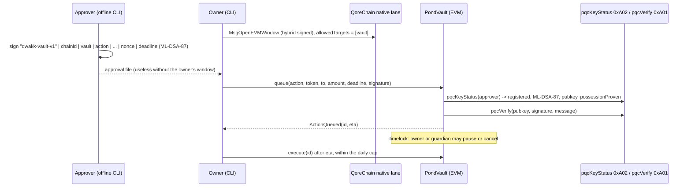

# Qwakk Pond Vault

A post-quantum guarded vault for Qwakk's interface fees on the QoreChain EVM.
Qwakk's entry in Build Before Q-Day, **Post-Quantum dApp** category.

Anyone can pay QOR, fUSD, fETH or fBTC into the vault. Getting anything out,
or changing a rule, takes two signatures, one of them post-quantum, and then a
wait that anyone can watch. The two keys are independent only when the approver
is a separate account (see Roles):

1. **The owner's transaction.** On QoreChain an EVM transaction is admitted only
   inside an EVM authorisation window that the account opened with a hybrid
   (secp256k1 + ML-DSA-87) signed native message. The owner opens a window
   **scoped to the vault address only**.
2. **An ML-DSA-87 approval.** The approver's post-quantum key (the one its
   account registered on QoreChain, with a proof of possession) signs a
   domain-separated message. The contract reads that key live from the
   `pqcKeyStatus` precompile and checks the signature with the `pqcVerify`
   precompile, inside the transaction.
3. **A timelock and a daily cap.** Approved actions wait out a timelock before
   anyone can execute them, and withdrawals are limited per token per UTC day.
   The owner or a guardian can pause and cancel in the meantime.

A quantum attacker who forges secp256k1 signatures gets nothing: they cannot
open a window, and they cannot produce an ML-DSA-87 approval.



## Status

| | |
| --- | --- |
| Contract, tests, CLI, dashboard | Built. `forge test`: 53 unit, 9 fuzz (1,024 runs each, 4,096 in CI), 3 invariants (128 runs x 64 calls); forge reports 63 passed. CLI `npm test`: 17 of 17 passed. Both run again on 2026-11-15. |
| ML-DSA-87 vectors | 12 real vectors, each verified by Diana's live `pqcVerify` precompile with an `eth_call` (true), and a tampered copy of each refused (false), on 2026-11-14. |
| Full CLI flow | Rehearsed end to end on a local anvil node with stand-in precompiles (deploy, deposit, queue, approval file, pause, approved unpause, cancel, execute, smoke). |
| On QoreChain Diana | **Deployed and tested on 2026-11-15.** Deposit, an ML-DSA-87 approved withdrawal checked on chain by `pqcVerify`, and its execution after the timelock all succeeded. See "Diana deployment" below. |
| Replay on Diana | Not run live: the smoke script stopped after the deposit, and the remaining steps were run by hand without the replay `eth_call`. The vault's nonce advanced to 1 after the queue. Replay rejection is proven by the Foundry tests. |
| Fee route into the vault | **Pending.** Interface fees go straight to the testnet treasury `qor1wl5jxt3n5fxez4csxe7t67xcfyvxr69y3mn4dq` today. `native-send-test` has not been run. |
| QCAI audit | **Pending.** See "QCAI audit (two stages)". |

### Diana deployment

QoreChain testnet `qorechain-diana`, EVM chain id 9800. Explorer links use
`https://explore.qore.network/tx/<hash>`.

| | |
| --- | --- |
| Vault | `0x6fEFdEA7209797c116747450b12695AccbE81133` (`qor1dlhaafeqj7tuz9n5w3gtzf544n97syfn0c2axu`) |
| Owner and approver (one testnet-only account, also the Q-Day Drill account) | `0x50879493D6cE5834113DDf2A042F643d1C07CCf8` (`qor12zrefy7keevrgyfamu4qgtmy85wq0n8cxrd3s3`) |
| Settings | Timelock 120 s, native daily cap 10 QOR, no guardian |
| Source | The deployed runtime bytecode equals `forge build` of `src/` at `6f5a34b` (compared on 2026-11-15) |
| Dashboard | <https://app.qwakk.fun/vault> |

| Step | Transaction |
| --- | --- |
| ML-DSA-87 key registration with proof of possession | [`CAF3DA17...D17E7`](https://explore.qore.network/tx/CAF3DA17E2742D9879E05F85FFB42B7105151022E443E794E3B9BC622E0D17E7) |
| Unscoped deploy window (1 transaction) | [`6EFDDB8B...43123`](https://explore.qore.network/tx/6EFDDB8B1679F56A0B63EAA9B3DD22FF5F03AB36584CBBAF7D55B233C7143123) |
| Deploy (2,131,623 gas) | [`0x694cd9f1...2b874`](https://explore.qore.network/tx/0x694cd9f1d55f4498f4f605c2001c48be2694cee6644a26a4c50ab23e54c2b874) |
| Window scoped to the vault only (`allowedTargets=[vault]`, 4 transactions) | [`36162FA0...AD5AA`](https://explore.qore.network/tx/36162FA0EE1C0D4AB9A19A36CDE709DFA2981348CE0164C773F8CF0A9F2AD5AA) |
| Deposit 100 QOR | [`0x17c8eeb9...c63ae`](https://explore.qore.network/tx/0x17c8eeb99fbd01a516e621a63e1f37d55913a86aec166c8ddce89ad1b1dc63ae) |
| Queue a 0.005 QOR withdrawal with an ML-DSA-87 approval, verified on chain by `pqcVerify` (328,598 gas) | [`0xfb3f4c20...e3ba6`](https://explore.qore.network/tx/0xfb3f4c2063322de1db03ea9a440599cb492d5364d8a1b4ee02f4873dc0ee3ba6) |
| Execute after the timelock | [`0x84a73b40...343ad`](https://explore.qore.network/tx/0x84a73b40813c0a0dfa120ea26e0cb4a72e3b13839162a0d33109595b273343ad) |

The Q-Day Drill is registered on the project page with the account and the
vault above. The drill has not run yet.

## Layout

```
src/PondVault.sol                 the vault
src/interfaces/IQorePQC.sol       pqcVerify / pqcKeyStatus (four return values, as Diana answers)
test/PondVault.t.sol              unit and negative tests with real ML-DSA-87 vectors
test/PondVault.fuzz.t.sol         fuzz (timelock, cap, deadlines, roles, nonces) and invariants
test/fixtures/pq-vectors.json     the vectors (generated, reproducible byte for byte)
test/utils/                       shared setup, ERC-20 mocks, anvil stand-ins for the precompiles
script/DeployPondVault.s.sol      Foundry deploy script for the anvil rehearsal only (refuses other chains)
cli/                              owner and approver CLI (TypeScript, viem, QoreChain SDK)
```

The read-only dashboard lives in the app: `app/vault/page.tsx`,
`components/VaultView.tsx`, `app/api/vault/route.ts`, `lib/qwakk-vault.ts`.

## The contract

### Roles

| Role | Can | Cannot |
| --- | --- | --- |
| Owner | send `queue`, `unpause`, `pause`, `cancel`, `execute` | move funds or change rules without an ML-DSA-87 approval |
| Approver | sign approvals with its registered ML-DSA-87 key | send anything to the vault on its own behalf |
| Guardian (optional) | `pause`, `cancel` | queue, unpause, or cancel its own replacement |
| Anyone | deposit, `execute` a ready action | skip the timelock or the cap |

**Default setup: one account.** Unless `QORE_APPROVER_MNEMONIC` is set, the
approver is the owner's own account, so one mnemonic holds both the secp256k1
key and the ML-DSA-87 key. That still stops a quantum attacker and a thief who
has only the secp256k1 key, but not someone who has the mnemonic itself. The
`/vault` page says so when owner and approver are the same account.

For independent keys, give the approver its own mnemonic on another machine
(`QORE_APPROVER_MNEMONIC`), sign with `approve ... --out file` there, and queue
with `queue --approval file` on the owner's machine.

### Actions

Every sensitive action is queued and runs after the timelock.

| # | Action | Fields used | Notes |
| --- | --- | --- | --- |
| 1 | `Withdraw` | token, to, amount | token `0x0` = native QOR (18 decimals on the EVM lane). Checked against the daily cap at execution. Blocked while paused. |
| 2 | `SetDailyCap` | token, amount | 0 locks that token. ERC-20 caps start at 0. |
| 3 | `SetTimelock` | amount (seconds) | 60 s to 30 days. Never shortens actions already queued. |
| 4 | `SetOwner` | to | |
| 5 | `SetApprover` | to | `to` must hold a usable ML-DSA-87 key at queue and at execution. |
| 6 | `SetGuardian` | to (0 removes) | Runs even while paused, so a bad guardian can always be replaced. |
| 7 | `Unpause` | none | Not queued: takes effect at once. Queued actions keep their own eta. |

Fields an action does not use must be zero, so every action has exactly one
valid encoding.

### The approval message

203 bytes, every field fixed width, so packing is unambiguous:

```
"qwakk-vault-v1" (bytes14) | chainid (uint256) | vault (address) | action (uint8)
| token (address) | to (address) | amount (uint256) | nonce (uint256) | deadline (uint256)
```

- `nonce` is the vault's sequential approval counter: each approval works once, in order.
- `chainid` and `vault` bind it to one chain and one vault.
- `deadline` must be in the future and at most 1 day ahead (`MAX_APPROVAL_TTL`).
- The signed bytes are the message itself (not a hash). `pqcVerify` takes "the
  original message bytes" (docs: developer-guide/evm-precompiles), and Diana's
  precompile verified exactly these bytes for every vector.
- The vault exposes `approvalMessage(...)`. The CLI refuses to sign unless its own
  encoding equals the vault's.

### Checks, in order

`queue`: sender is owner; parameters canonical; not paused (for withdrawals);
deadline in range; signature is 4,627 bytes; `pqcKeyStatus(approver)` says
registered, algorithm 1 (ML-DSA-87), `possessionProven`, 2,592-byte key;
`pqcVerify(pubkey, signature, message)` returns exactly true; then the nonce is
used and `ApprovalVerified(nonce, approver, action, keccak256(message))` is logged.

Both precompile calls fail closed: an inactive precompile (which answers with
empty data on networks where it is off) or odd return data reads as "no key" or
"invalid".

`execute`: action is queued; `eta <= now <= eta + 7 days`; for withdrawals, not
paused and within today's cap. State changes before the transfer, and a
reentrancy guard covers `queue`, `unpause`, `execute` and `depositToken`.

### Events

`Deposited`, `ApprovalVerified`, `ActionQueued`, `ActionExecuted`,
`ActionCancelled`, `Withdrawn`, `DailyCapSet`, `TimelockSet`, `OwnerSet`,
`ApproverSet`, `GuardianSet`, `Paused`, `Unpaused`.

## Tests

```sh
cd contracts
forge install foundry-rs/forge-std@v1.17.0 --no-git   # once
forge build
forge test                                            # FOUNDRY_PROFILE=ci for 4,096 fuzz runs
cd cli && npm ci && npm test
```

Foundry's EVM has no QoreChain precompiles, so the tests mock them with
`vm.mockCall` to answer exactly what Diana answers:

- `pqcVerify` returns true **only** for the exact `(pubkey, signature, message)`
  triples in `test/fixtures/pq-vectors.json` and false for anything else. Those
  vectors are real ML-DSA-87 signatures that Diana's precompile verified.
- `pqcKeyStatus` returns Diana's four values, and `(false, 0, "", false)` for an
  account without a key.

So a test that tampers with one byte, replays an approval or moves it to another
chain or vault fails for the same reason it would fail on Diana: the bytes the
contract builds are no longer the bytes that were signed.

| Suite | What it proves |
| --- | --- |
| Encoding | All 12 vectors: the contract's `approvalMessage` equals the TypeScript encoder's bytes. |
| Negative | Replay, replay on another chain, signed for another chain, replay on another vault, signed for another vault, expired, too long lived, tampered signature, tampered amount, tampered recipient, wrong signature length, non-owner sender, guardian sender, approver key removed, approver key rotated on chain, key without proof of possession, wrong key length, precompiles inactive (fails closed), non-canonical parameters. |
| Flows | Withdraw QOR, set a token cap then withdraw the token, timelock, owner, guardian and approver rotation (old key refused afterwards), pause, approved unpause, cancel, guardian limits, reentrant recipient, false-returning token. |
| Fuzz | Timelock window (execution succeeds exactly between eta and eta + grace), a timelock change never shortens queued actions, daily cap within a day, cap reset exactly at the UTC boundary, zero cap locks a token, deadline window, only the owner queues, only owner or guardian pause and cancel, sequential nonces. |
| Invariants | No UTC day pays out more than the cap; balance is conserved (in minus out); nonce equals actions queued. |
| CLI (`npm test`) | Encoder against every vector, both official verifiers accept every vector, signatures do not carry over, decode round trip, field validation, ABI and app selectors match the compiled contract. |

Regenerate the vectors (deterministic, so the file does not change):

```sh
cd contracts/cli
npm run vectors -- --live   # --live: also checks each vector on Diana with eth_call
```

## Owner runbook (QoreChain Diana)

The vault in "Diana deployment" was deployed and tested with these steps on
2026-11-15. Step 9 stopped after the deposit, so the queue and the execute were
then run by hand. Every command that sends something prints what it will do and
waits for "yes".

**Prerequisites:** Foundry 1.9 (`brew install foundry`, or `foundryup`), Node.js
22.13 or later, test QOR from the faucet
([dashboard.qorechain.io/faucet](https://dashboard.qorechain.io/faucet), 100 QOR every 24 hours).

| Step | Command (from `qwakk-app/contracts`) | Env vars it needs | Sends |
| --- | --- | --- | --- |
| 1 | `forge install foundry-rs/forge-std@v1.17.0 --no-git && forge build && forge test` | none | nothing |
| 2 | `cd cli && npm ci && npm test` | none | nothing |
| 3 | `cp .env.example .env`, then set `QORE_MNEMONIC` to a **new, testnet-only** mnemonic (`cast wallet new-mnemonic`) | | nothing |
| 4 | `cd cli && npm run pond -- status` (prints the owner's `qor1` address; fund it from the faucet) | `QORE_MNEMONIC` | nothing |
| 5 | `npm run pond -- register` | `QORE_MNEMONIC` | native tx (classical, the one message the chain accepts that way), fee 0.1 QOR: registers the ML-DSA-87 key with a proof of possession. If the account already has a key, it sends nothing and exits with an error unless that key is this mnemonic's, with a proof of possession. |
| 6 | `npm run pond -- window deploy` | `QORE_MNEMONIC` | native tx (hybrid), fee 0.1 QOR: unscoped window, 1 transaction |
| 7 | `npm run pond -- deploy`, then put the printed `POND_VAULT_ADDRESS` in `.env` | `QORE_MNEMONIC`, optional `POND_TIMELOCK_SECONDS` (120), `POND_NATIVE_DAILY_CAP_QOR` (10), `POND_GUARDIAN` | EVM deploy inside the window. Refuses unless the approver's registered key (read through `pqcKeyStatus`) is the key its mnemonic derives. This is the supported deploy path. |
| 8 | `npm run pond -- window vault --txs 4 --deposit-qor 0.01` | `QORE_MNEMONIC`, `POND_VAULT_ADDRESS` | native tx (hybrid), fee 0.1 QOR: window scoped to the vault only |
| 9 | `npm run pond -- smoke` | `QORE_MNEMONIC`, `POND_VAULT_ADDRESS`, optional `POND_SMOKE_DEPOSIT_QOR`, `POND_SMOKE_WITHDRAW_QOR` | 3 EVM txs: deposit, queue (with ML-DSA-87 approval), execute. The replay check is an `eth_call`. |
| 10 | `npm run pond -- status` | same | nothing |
| 11 | In the app: set `QWAKK_VAULT_ADDRESS` (web, testnet) and open `/vault` | | nothing |

Optional:

- `npm run pond -- native-send-test` sends 1 uqor on the native lane to the
  vault's `qor1` address and checks that the vault's EVM balance rises by
  10^12 wei. Only if it does should `QWAKK_TREASURY_ADDRESS` ever point at the
  vault. Until then this tie-in is **unverified**.
- A second, offline approver: set `QORE_APPROVER_MNEMONIC` on the approver's
  machine, run `npm run pond -- register --approver` once, deploy with that
  approver (the CLI uses it automatically), then
  `npm run pond -- approve withdraw --token QOR --to 0x... --amount 1 --out a.json`
  there and `npm run pond -- queue --approval a.json` on the owner's machine.
- `script/DeployPondVault.s.sol` is for the anvil rehearsal only and refuses
  any other chain. Foundry runs a script on a local fork before broadcasting,
  and QoreChain's precompiles are native code that a fork does not have, so the
  constructor's key check would revert before anything is sent. It also cannot
  check that the registered key matches the mnemonic. Deploy on Diana with the
  CLI (step 7).

Other commands: `queue withdraw|cap|timelock|owner|approver|guardian|unpause`,
`execute <id>`, `cancel <id>`, `pause`, `window close`. Run
`npm run pond -- help`.

### Window sizing

- Diana makes about 0.7 blocks per second (10,000 blocks in 14,246 s on
  2026-11-14), so the default 1,800-block window lasts about 43 minutes.
- A window bounds value plus the maximum fee of each transaction
  (`evmWindowCost`). The CLI sizes `window vault` for 1,000,000 gas per
  transaction at a 250 gwei fee cap (`POND_MAX_FEE_GWEI`) plus the deposit, and
  caps each transaction's fee at the same number. A `queue` used about 0.38 to
  0.42 million gas in the anvil rehearsal with a stand-in verifier; the real
  `pqcVerify` costs 25,000 gas plus 8 per input byte (docs), about 85,000 here.
- A window with `allowedTargets` refuses contract creation, so deploying needs
  the unscoped `window deploy` first.
- Opening a window advances the account's nonce and replaces any open window.
- The docs say a scoped window must also list a standard precompile that a
  transaction is sent to. The vault calls `pqcVerify` and `pqcKeyStatus`
  internally, and on Diana that does **not** need them listed: on 2026-11-15
  `queue` succeeded inside a window with `allowedTargets=[vault]` only (see
  "Diana deployment"). `POND_WINDOW_EXTRA_TARGETS` stays available but is not
  needed for the vault.
- Deploying PondVault costs about 2.13 million gas (Foundry gas report), inside
  the 3,000,000 gas the deploy window is sized for.

## Local rehearsal (anvil)

Runs the real CLI against a local node, with stand-ins for the precompiles
(`test/utils/DevnetPrecompiles.sol`). The stand-in verifier accepts any
well-formed signature, so this proves the CLI and contract plumbing, not the
cryptography (the Foundry tests and Diana do that).

```sh
anvil --block-time 1 &
forge build
cast rpc anvil_setCode 0x0000000000000000000000000000000000000a01 $(forge inspect DevnetPqcVerify deployedBytecode)
cast rpc anvil_setCode 0x0000000000000000000000000000000000000a02 $(forge inspect DevnetPqcKeyStatus deployedBytecode)
# put the owner's real ML-DSA-87 public key (derived from QORE_MNEMONIC) in the
# stand-in with setKey(address,bytes), fund the owner, then:
POND_DEVNET_RPC=http://127.0.0.1:8545 npm --prefix cli run pond -- deploy
# or, with Foundry (anvil only):
forge script script/DeployPondVault.s.sol --rpc-url http://127.0.0.1:8545 --broadcast
```

`POND_DEVNET_RPC` skips QoreChain's window checks (anvil has no native lane)
and refuses native-lane commands.

## Threat model

| Threat | What happens | Why |
| --- | --- | --- |
| Quantum attacker forges secp256k1 signatures (Q-Day) | Nothing moves. | Opening an EVM window needs a hybrid signature with ML-DSA-87, and every sensitive vault action needs an ML-DSA-87 approval checked on chain. |
| Owner's secp256k1 key stolen | Nothing moves. | The thief cannot open a window without the ML-DSA-87 key. Inside a window the owner already opened (scoped to the vault), they still cannot queue without an approval; at worst they pause or cancel. The owner closes the window (`window close`, hybrid signed) and moves the owner role to a fresh account (see "Recovering from a leaked key"). |
| Approver's ML-DSA-87 key stolen | Nothing moves while the owner's keys are safe. | An approval only works when the owner sends it. The owner moves the approver role to a fresh account with a queued `SetApprover` (see below). The contract also reads the approver's key live, so a key rotated on QoreChain's native lane would end old-key approvals at once (tested), but this CLI cannot rotate keys or sign with a rotated key, so that is not a supported recovery path here. |
| Owner and approver are one account and both its keys are stolen | Slowed, not stopped: every withdrawal and every cap or role change waits out the timelock, and withdrawals stay within the cap in force. | The guardian (another account) can pause and cancel during the timelock. If nobody reacts, the attacker can raise the cap after one timelock. Use a separate approver, a guardian and a long timelock for real funds. |
| Replay | Refused. | Nonce, chain id, vault address and deadline are all signed (tests: replay, other chain, other vault, expired). |
| Malicious or compromised front end | Cannot obtain an approval. | The dashboard is read only and never asks for a signature. Approvals are signed in the local CLI, which shows the decoded fields, cross-checks the bytes with the vault's `approvalMessage`, and checks the signature with `pqcVerify` before sending. QoreX refuses `signArbitrary`, so there is no browser signing surface to phish. |
| Lying RPC node | Can make the CLI refuse, not sign something else. | The CLI signs only what it encoded and displayed locally; the on-chain cross-check can fail but cannot change those bytes. |
| Rogue guardian | Delay only. | It can pause and cancel but not queue, unpause or cancel its own replacement; `SetGuardian` runs even while paused. |
| Precompile missing or broken | Fails closed. | Empty or odd answers read as "no key" or "invalid" (tested). |
| Odd tokens | Handled. | Tokens returning false or nothing are handled; deposits record the amount actually received; reentrancy guarded. |

### Recovering from a leaked key

The supported path is to move the role to a fresh account. Both moves are
queued, so they wait out the timelock; a guardian can pause meanwhile.

- **Approver key leaked.** Make a fresh testnet-only mnemonic and fund its
  account. Put it in `.env` as `QORE_APPROVER_MNEMONIC` and run
  `npm run pond -- register --approver`. Then switch `QORE_APPROVER_MNEMONIC`
  back to the current approver (remove it if the approver is the owner), run
  `npm run pond -- queue approver --to <new 0x address>`, wait for the timelock and
  run `npm run pond -- execute <id>`. From then on, set `QORE_APPROVER_MNEMONIC`
  to the new mnemonic.
- **Owner's secp256k1 key leaked.** While a window is open, the thief can send
  as the owner (pause, cancel), so keep the old owner's windows to one
  transaction:
  1. `npm run pond -- window close` (old owner).
  2. With a fresh, funded mnemonic as `QORE_MNEMONIC`: `npm run pond -- register`.
  3. Back on the old owner's mnemonic: `npm run pond -- window vault --txs 1`,
     then at once `npm run pond -- queue owner --to <new 0x address>`. The
     one-transaction window leaves the thief nothing to cancel with.
  4. On the new mnemonic: `npm run pond -- window vault --txs 2` and, after the
     timelock, `npm run pond -- execute <id>` (anyone may execute).
- **The single shared mnemonic leaked** (default setup). Both moves above are
  still possible, but so are the thief's: pause with the guardian if you have
  one, cancel the thief's queued actions, and move both roles.

Known limits: the daily cap uses fixed UTC days, so up to twice the cap can
leave around midnight UTC. Block timestamps can drift by seconds; keep timelocks
in minutes or more. The vault cannot see the owner's window; QoreChain enforces
it. On mainnet the PQC precompiles are not active today, so the vault is
testnet only and the CLI refuses `QORE_NETWORK=mainnet`.

## QCAI audit (two stages)

The tool is the QoreChain dashboard's AI Smart Contract Auditor
(https://dashboard.qorechain.io/audit, runs on QCAIA). It reviews pasted source
and returns a security score, a risk level, a post-quantum readiness score and
findings, exportable as PDF. The exact two-stage procedure for the fest has been
requested from QoreChain; until it is confirmed, stage 2 is a second run after
our responses below.

| Stage | When | Scope | Report | Result |
| --- | --- | --- | --- | --- |
| 1 | 2026-11-15, after deployment | `src/PondVault.sol` and `src/interfaces/IQorePQC.sol`, flattened, at `6f5a34b` (the deployed source; unchanged since) | [`audit/qcai-stage1-pondvault-2026-11-15.pdf`](audit/qcai-stage1-pondvault-2026-11-15.pdf) | Security score 85/100, risk level Medium, 5 findings. Quantum readiness "not scored for this setting" (the tool auto-detected the source as Ethereum). |
| 2 | _pending_ | same source | _pending_ | _pending_ |

The vault went on Diana on 2026-11-15 before stage 1 ran, so stage 1 reviewed the
source of the deployed vault. A code change from either stage needs a new
deployment.

### Stage 1 findings and our responses

The report's line numbers do not match the source file, so the table names the
functions instead.

| Finding (report severity) | Our assessment | Evidence |
| --- | --- | --- |
| Potential reentrancy via external calls (High) | Not exploitable. `execute` marks the action `Executed`, and `_spend` records the day's spend, before `_send` makes the external call; nothing changes state after it. `queue`, `unpause`, `execute` and `depositToken` share a reentrancy guard. `pause` and `cancel` are owner or guardian only. | `test_ReentrantRecipientCannotReenter` |
| Missing access control for key rotation (Medium) | By design, already guarded. `SetApprover` needs the owner's transaction, a fresh ML-DSA-87 approval from the current approver and the timelock. The new approver's key must be registered, ML-DSA-87, 2,592 bytes and possession proven, checked at queue and again at execute. | `test_RotateApproverToSecondKey`, `test_RevertWhen_NewApproverHasNoKeyAtQueue`, `test_RevertWhen_NewApproverLostKeyBeforeExecute` |
| Potential overflow in daily cap calculation (Medium) | Not possible as described. The contract compiles with Solidity 0.8.28, whose checked arithmetic reverts on overflow, so `spent + amount` can never wrap and pass the cap. A revert would also need amounts near 2^256. | `testFuzz_DailyCapWithinOneDay`, the "no UTC day pays out more than the cap" invariant |
| Unchecked return data from token transfers (Low) | Intended. `_callToken` accepts a token that returns `true` or nothing and refuses `false`, a revert, any other return data or a non-contract, so an unusual token fails closed. | `test_RevertWhen_TokenReturnsFalse`, `test_RevertWhen_DepositTokenIsNotAContract` |
| Timestamp dependency in the timelock (Info) | Accepted. Timelocks are 60 s to 30 days and approvals live at most 1 day, so a few seconds of block time drift cannot skip a timelock in a useful way. Listed under Known limits above. | `test_RevertWhen_TimelockOutOfBounds`, `test_RevertWhen_ExecutedBeforeTimelock` |

No code change was needed, so the deployed vault stands.

## Kits and network features used

| Kit | Version | Used for |
| --- | --- | --- |
| `create-qorechain-dapp` (Foundry template) | 0.14.0 | Project base: `foundry.toml`, named RPCs, the window helper the CLI grew from |
| `@qorechain/sdk` | 0.14.0 | `deriveUnifiedAccount`, `EthNativeSigner` (hybrid and classical native txs), `openEvmWindowMsg` with `allowedTargets`, `closeEvmWindowMsg`, `buildRegisterPqcKeyMsg`, `signProofOfPossession`, `fetchPqcStatus`, `isRegisteredPqcKey`, `pqcSign`, `pqcVerify`, `getNetwork` |
| `@qorechain/evm` | 0.14.0 | `evmWindowStatus`, `evmWindowCost`, `weiToUqorCeil`, `classifyEvmWindowRejection`, `IQORE_PQC_ABI`, `PRECOMPILE_ADDRESSES`, `qorechainTestnet`, `toQorAddress` |
| `@qorechain/pqc` | 0.2.3 | `mldsa87` keygen, sign and verify for the test vectors |
| `@qorechain/sdk` (app) | 0.8.2 | `hexToBech32` for the dashboard's window lookup |
| Foundry, forge-std | 1.9.0, 1.17.0 | Build, unit, fuzz and invariant tests, anvil deploy script |
| viem | 2.x | EVM reads and writes in the CLI |

Network features: scoped EVM authorisation window (`allowedTargets`), the
`pqcVerify` precompile (0xA01), the `pqcKeyStatus` precompile (0xA02,
including `possessionProven`), ML-DSA-87 key registration with proof of
possession, hybrid-signed native transactions, the unified account (`qor1` and
`0x` are the same 20 bytes), and the Diana ERC-20 test tokens.

Reference: [qorechain/build-before-qday](https://github.com/qorechain/build-before-qday)
(workshop 1: `01-qday-counter/scripts/window.ts`).

### Notes for the QoreChain team

- `pqcKeyStatus` answers four values on Diana (`registered, algorithmId, pubkey,
  possessionProven`), as the docs say, but `IQORE_PQC_ABI` in
  `@qorechain/evm@0.14.0` lists three.
- `PRECOMPILE_ADDRESSES` in `@qorechain/evm@0.14.0` spells `0x...0A01` and
  `0x...0A02` in a case that is not a valid EIP-55 checksum, so viem refuses them
  as given. The CLI lowercases them first.

## License

MIT, like the rest of this repository.
